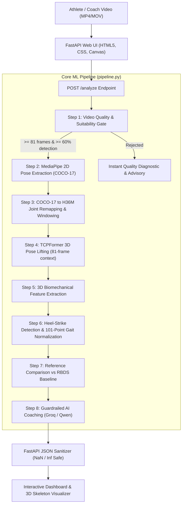

# AthletePose3D: AI Sports Technique Coach
## Comprehensive System Overview

---

### 1. Executive Summary

The **AI Sports Technique Coach** is an end-to-end computer-vision and artificial-intelligence system that transforms standard monocular running video footage into clinical-grade biomechanical insights and actionable athletic coaching feedback.

Traditional running gait analysis requires expensive motion-capture laboratories, retro-reflective body markers, force plates, and biomechanists. This project democratizes gait analysis by coupling:
1. **Monocular 2D Pose Estimation** ([Google MediaPipe](https://developers.google.com/mediapipe))
2. **Temporal 3D Kinematic Lifting** ([TCPFormer](https://github.com/AsukaCamellia/TCPFormer) pre-trained on the AthletePose3D dataset)
3. **Biomechanical Kinematics & 101-Point Gait-Cycle Normalization**
4. **Reference Comparison against Elite/Healthy Distributions** (RBDS Running Dataset)
5. **Guardrailed Biomechanical LLM Coaching** ([Groq](https://groq.com) / Qwen 2.5/3.8 / LLaMA)

The resulting web application allows an athlete or coach to upload a short running video from a mobile phone and receive an interactive dashboard with 3D pose playback, joint flexion angles, gait cycle breakdown, technique deviation metrics, and sports coaching recommendations within seconds.

---

### 2. High-Level System Architecture



---

### 3. Key Capabilities & Deliverables

| Capability | Implementation | Value Delivered |
|---|---|---|
| **Video Suitability Gating** | 30-frame MediaPipe probe + frame count check | Rejects sub-optimal angles and occluded footage early, preventing corrupted downstream analysis. |
| **Monocular to 3D Lifting** | 16-layer MemoryInduced Transformer (TCPFormer) | Reconstructs true 3D spatial joint coordinates `(x, y, z)` without multi-camera setups or markers. |
| **Gait-Cycle Normalization** | Ankle vertical minima peak detection + 101-pt spline interpolation | Standardizes strides across different runners, heights, and cadences to 0%–100% gait cycle. |
| **Technique Deviation Engine** | Ground truth mean, standard deviation, and range comparison | Pinpoints hyperextension, knee flexion deficits, and bilateral leg asymmetries. |
| **Guardrailed LLM Coach** | Strict system prompt with 10 ethical coaching rules | Prevents hallucinations, injury diagnosis, or toxic feedback; outputs 4 structured sections. |
| **Interactive Dashboard** | Vanilla JavaScript HTML5 Canvas & Dark-Mode CSS | Zero external visual library bloat; real-time 17-joint animated skeleton playback and metrics. |

---

### 4. Repository Structure

```
Sprint_Coach/
│
├── app.py                     # FastAPI application server, upload handling, JSON sanitization
├── pipeline.py                # Core ML pipeline (steps 1 through 8)
├── requirements.txt           # Python dependencies
├── .env                       # Environment variables (GROQ_API_KEY)
├── PROJECT_README.txt         # Original project notes & persistent storage layout
│
├── models/                    # Pre-trained deep learning checkpoints
│   ├── pose_landmarker_full.task   # MediaPipe Pose Landmarker float16 model
│   └── TCPFormer_ap3d_81.pth.tr    # TCPFormer 81-frame checkpoint (AthletePose3D)
│
├── data/                      # Reference datasets & baseline distributions
│   ├── Running_0_cam_1_TCPFormer_features_normalized.csv
│   ├── Running_0_cam_1_TCPFormer_features.csv
│   ├── Running_0_cam_1_GroundTruth_features_normalized.csv
│   └── Running_0_cam_1_GroundTruth_features.csv
│
├── TCPFormer/                 # TCPFormer model architecture package
│   ├── model/
│   │   ├── Model.py           # MemoryInducedTransformer definition (CPU/CUDA agnostic)
│   │   └── modules/           # Spatial/temporal attention blocks
│   └── configs/               # Model hyperparameter YAMLs
│
├── templates/
│   └── index.html             # Dashboard single-page application structure
│
├── static/
│   ├── script.js              # Frontend controller, API integration & skeleton canvas engine
│   └── styles.css             # Cyberpunk/minimalist dark theme stylesheet
│
├── uploads/                   # Temporary storage for processing incoming video uploads
└── documentation/             # Project technical documentation
    ├── 01_PROJECT_OVERVIEW.md
    ├── 02_ARCHITECTURE_AND_PIPELINE.md
    ├── 03_DASHBOARD_AND_METRICS.md
    ├── 04_LLM_COACHING_AND_PROMPTS.md
    └── 05_TROUBLESHOOTING_AND_DEPLOYMENT.md
```

---

### 5. Tech Stack Summary

- **Backend Framework:** FastAPI, Uvicorn, Starlette
- **Deep Learning & Math:** PyTorch (TorchVision), Timm, Einops, NumPy, SciPy, Pandas
- **Computer Vision:** OpenCV (cv2), Google MediaPipe Tasks Vision
- **Generative AI / LLM:** Groq SDK (`qwen/qwen3.8-27b`, `openai/gpt-oss-120b`, `llama-3.3-70b-versatile`)
- **Frontend:** Semantic HTML5, CSS Variables, HTML5 Canvas API, Vanilla ECMAScript (ES6+)

---

### 6. Quickstart Guide

1. **Activate Environment & Install Requirements:**
   ```powershell
   pip install -r requirements.txt
   ```

2. **Configure API Keys:**
   Ensure `.env` contains your valid Groq API key:
   ```env
   GROQ_API_KEY=gsk_your_key_here
   ```

3. **Launch Server:**
   ```powershell
   uvicorn app:app --reload --port 8000
   ```

4. **Access Web Application:**
   Navigate to [http://localhost:8000](http://localhost:8000) in your web browser.

