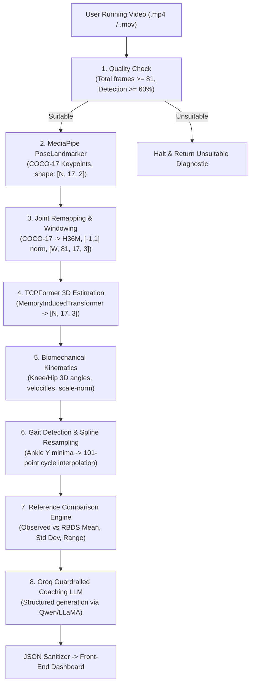

# End-to-End Pipeline & Architecture Specification

This document details the eight consecutive computational stages executed whenever a video is uploaded to `/analyze`.

---

### Pipeline Flowchart

---

### Detailed Stage Breakdown

#### Step 1: Video Quality & Suitability Gate (`check_video_quality`)
Before performing compute-intensive inference, the video passes through a gating check:
- **Frame Length Gate:** Must contain at least **81 frames** (~2.7 to 3.0 seconds at 30 FPS). TCPFormer requires an 81-frame context window.
- **Pose Detection Ratio Gate:** The probe extracts ~30 evenly spaced sample frames and passes them to `mediapipe.tasks.python.vision.PoseLandmarker`.
- **Threshold:** If fewer than **60%** of sampled frames detect a human pose, the video is rejected with a descriptive message explaining camera position, lighting, and framing recommendations.

#### Step 2: MediaPipe 2D Pose Extraction (`extract_2d_pose`)
- Iterates over all video frames in sequence.
- Extracts the standard MediaPipe Pose 33-landmark skeleton.
- Filters down to **17 COCO landmarks** via `MP_TO_COCO` mapping:
  `[0, 2, 5, 7, 8, 11, 12, 13, 14, 15, 16, 23, 24, 25, 26, 27, 28]` (Nose, Eyes, Shoulders, Elbows, Wrists, Hips, Knees, Ankles).
- Coordinates are normalized in $[0, 1]$ screen space. Any undetected frames are safely tracked.

#### Step 3: Joint Remapping & Windowing (`prepare_tcpformer_input`)
TCPFormer was trained on the **Human3.6M (H36M) / AthletePose3D** joint topology. The pipeline maps COCO-17 coordinates to 17 H36M joints:
- **Pelvis (Joint 0):** Computed as the midpoint: $\text{avg}(\text{Right Hip}, \text{Left Hip})$.
- **Spine (Joint 7):** Computed as the midpoint between shoulder center and hip center.
- **Clavicle / Neck (Joints 8, 9):** Derived from shoulder midpoints and nose.
- **Coordinate Transformation:** Values are converted from MediaPipe $[0, 1]$ space to TCPFormer $[-1, 1]$ convention:
  $$x_{\text{norm}} = 2x - 1, \quad y_{\text{norm}} = 2y - 1$$
- **Confidence Layer:** Appends a third channel ($c = 1.0$) for a $(17, 3)$ frame representation.
- **Window Slicing:** Partitions the temporal sequence into non-overlapping $(W, 81, 17, 3)$ arrays.

#### Step 4: TCPFormer 3D Pose Estimation (`run_tcpformer`)
- Model Architecture: `MemoryInducedTransformer`
  - Layers: 16
  - Feature Dim: 128
  - Representation Dim: 512
  - Temporal Receptive Field: 81 consecutive frames
  - Checkpoint: `TCPFormer_ap3d_81.pth.tr` (AthletePose3D pre-trained)
- Output: Spatial $(W \times 81, 17, 3)$ coordinate sequence representing real-world 3D joint locations in camera space:
  $$P_i = [X_i, Y_i, Z_i] \quad \text{for } i \in \{0, \dots, 16\}$$

#### Step 5: Biomechanical Kinematic Feature Extraction (`extract_features`)
From the reconstructed 3D coordinates, athletic kinematic features are computed:

1. **3D Joint Flexion Angles:**
   Computed via the vector dot product for 3 spatial points $(A, B, C)$ where $B$ is the joint vertex:
   $$\vec{u} = A - B, \quad \vec{v} = C - B$$
   $$\theta = \arccos\left(\frac{\vec{u} \cdot \vec{v}}{\|\vec{u}\| \|\vec{v}\|}\right) \times \frac{180}{\pi}$$
   - **Right Knee Flexion:** Angle between Right Hip $\to$ Right Knee $\to$ Right Ankle
   - **Left Knee Flexion:** Angle between Left Hip $\to$ Left Knee $\to$ Left Ankle
   - **Right Hip Angle:** Angle between Pelvis $\to$ Right Hip $\to$ Right Knee
   - **Left Hip Angle:** Angle between Pelvis $\to$ Left Hip $\to$ Left Knee

2. **Bilateral Asymmetries:**
   - Knee Angle Difference: $|\theta_{\text{Right Knee}} - \theta_{\text{Left Knee}}|$
   - Hip Angle Difference: $|\theta_{\text{Right Hip}} - \theta_{\text{Left Hip}}|$

3. **Spatial Speeds & Separation:**
   - Frame-by-frame ankle and knee velocities ($\|\Delta P / \Delta t\|$).
   - Leg length scale normalization: all spatial distances are divided by average leg length ($\frac{\text{Right Leg} + \text{Left Leg}}{2}$) to ensure invariance to athlete height and camera distance.

#### Step 6: Gait-Cycle Detection & 101-Point Normalization (`detect_gait_cycles`, `normalize_gait_cycles`)
- **Heel-Strike Detection:** Uses vertical ankle trajectory ($Y$-axis in camera coordinates). Local minima in right ankle height represent ground contacts (heel strikes).
- Peak detection algorithm (`scipy.signal.find_peaks`):
  $$\text{peaks} = \text{find\_peaks}(-Y_{\text{ankle}}, \text{distance}=15, \text{prominence}=0.005)$$
- **101-Point Normalization:** Each detected stride cycle (heel strike $k$ to heel strike $k+1$) is resampled using linear 1D spline interpolation (`scipy.interpolate.interp1d`) into 101 points representing **0% to 100% of the gait cycle**.
- Cycles are averaged together to compute the runner's characteristic technique waveform.

#### Step 7: Reference Comparison (`compare_to_reference`)
Compares the runner's observed biomechanical metrics against the elite reference dataset:
- **Reference Dataset:** `Running_0_cam_1_TCPFormer_features_normalized.csv` (RBDS Running Dataset).
- For each metric (Right Knee, Left Knee, Right Hip, Left Hip):
  - $\text{Observed Mean}$
  - $\text{Reference Mean}$
  - $\text{Reference Range } [\min, \max]$
  - $\text{Deviation} = \text{Observed Mean} - \text{Reference Mean}$
  - $\text{Within 1 Std Dev} = |\text{Deviation}| \le \sigma_{\text{ref}}$

#### Step 8: Guardrailed AI Coaching (`generate_coaching_feedback`)
Structured findings from Step 7 and metadata from Step 1 are formatted as JSON and sent to the Groq API. The LLM generates four coaching sections according to strict rules, parsed by regex and delivered to the dashboard.

