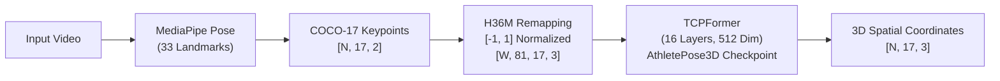

# Complete Project Guide: How It Was Built & Interview/Viva Preparation

This document is the master study and presentation guide for **Sprint Coach (AthletePose3D)**. It is structured to help you confidently explain the project to any audience—whether a professor, a technical interviewer, a software engineer, or a track coach.

---

## Table of Contents
1. [The 60-Second Elevator Pitch](#1-the-60-second-elevator-pitch)
2. [The 5-Minute Technical Narrative (How It Was Built)](#2-the-5-minute-technical-narrative-how-it-was-built)
3. [The Core Machine Learning Architecture](#3-the-core-machine-learning-architecture)
4. [The Biomechanics & Mathematical Algorithms](#4-the-biomechanics--mathematical-algorithms)
5. [Software Architecture & Systems Engineering](#5-software-architecture--systems-engineering)
6. [The LLM Coaching & Guardrail Layer](#6-the-llm-coaching--guardrail-layer)
7. [Top 15 Interview & Viva Questions (With Model Answers)](#7-top-15-interview--viva-questions-with-model-answers)

---

## 1. The 60-Second Elevator Pitch

> *"Sprint Coach is an end-to-end AI platform that democratizes clinical running gait analysis using only a standard mobile phone video.*
>
> *Traditional sports biomechanics requires expensive motion-capture marker suits, force plates, and biomechanists. Our system solves this with an 8-stage pipeline:*
> *First, it validates video quality and extracts 2D body landmarks using Google MediaPipe. Then, it uses TCPFormer—a 16-layer temporal transformer pre-trained on the AthletePose3D dataset—to lift those 2D coordinates into full 3D spatial joint coordinates across an 81-frame window.*
> *Next, it calculates 3D joint angles, automatically detects gait cycles via vertical ankle trajectories, and resamples strides into a standardized 101-point gait cycle.*
> *Finally, it compares the athlete's technique against elite collegiate baseline data (RBDS) and feeds the deviations through a guardrailed Groq LLM (Qwen) that translates raw angles into clear track cues and specific sprint drills.*
> *Everything is packaged in an asynchronous FastAPI web app with an interactive 3D skeleton visualizer that runs in real time."*

---

## 2. The 5-Minute Technical Narrative (How It Was Built)

When explaining how the project was created from scratch, divide your story into **five distinct phases**:

```
[Phase 1: Research & Problem Statement]
       │
       ▼
[Phase 2: Colab Prototyping (Sprint_model.ipynb)]
       │
       ▼
[Phase 3: Biomechanical Kinematics & Gait Normalization]
       │
       ▼
[Phase 4: Production Refactoring (FastAPI & pipeline.py)]
       │
       ▼
[Phase 5: Generative AI Coaching & Canvas Visualization]
```

### Phase 1: Problem Definition & Architecture Selection
- **The Challenge:** Monocular (single-camera) video has massive depth ambiguity. A human knee bending toward or away from the camera looks identical in 2D pixel space.
- **Why not MediaPipe 3D directly?** MediaPipe's "world landmarks" are single-frame heuristic approximations that suffer from severe temporal jitter, limb swapping, and foot sliding during fast dynamic motion like sprinting.
- **The Solution:** Decouple detection into two stages:
  1. High-speed, robust monocular 2D keypoint detection (MediaPipe).
  2. Temporal deep-learning 3D pose lifting using **TCPFormer** with an 81-frame receptive field trained on high-speed sports motions (**AthletePose3D**).

### Phase 2: Experimental Prototyping (`Sprint_model.ipynb`)
- Built and validated the entire ML pipeline in Google Colab.
- Processed sample athlete running videos (`Running_0_cam_1.mp4`).
- Implemented joint remapping: MediaPipe outputs 33 landmarks, mapped to 17 COCO landmarks, which were then mathematically converted to the 17 Human3.6M (H36M) joint convention used by TCPFormer.
- Verified that TCPFormer successfully generated smooth 3D trajectories without temporal flicker.

### Phase 3: Biomechanical Kinematics & Gait Normalization
- Extracted 3D joint flexion angles using vector dot-product formulas across hip, knee, and ankle vertices.
- Developed an automated gait-cycle detection algorithm based on vertical ankle trajectory minima (kinematic proxy for heel strike).
- Implemented 1D linear spline interpolation to normalize each stride cycle from frame-time space into a clinical **0% to 100% (101-point) gait continuum**.
- Built the comparison engine against the **RBDS (Running Biomechanics Dataset)** reference distribution.

### Phase 4: Production Refactoring & Systems Engineering
- Refactored the 11,000+ line notebook into clean, modular Python modules:
  - `pipeline.py`: Pure, self-contained 8-stage ML engine.
  - `app.py`: Asynchronous FastAPI web service.
- Implemented in-memory model caching so the 423 MB TCPFormer weights are loaded once upon server initialization rather than reloaded per video.
- Offloaded CPU-bound tensor operations to a background `ThreadPoolExecutor` so FastAPI's async event loop never freezes.
- Solved a critical bug in TCPFormer's upstream code where model layer-scale tensors had hardcoded `.to('cuda')`, making the entire model device-agnostic (CPU & CUDA compatible).
- Solved a critical `500 Internal Server Error` caused by strict RFC 8259 JSON serialization failing on `NaN` floats by writing a recursive `sanitize_for_json` utility.

### Phase 5: LLM Coaching Layer & Interactive Front-End
- Integrated Groq API (`qwen/qwen3.8-27b`) with low-latency inference.
- Engineered a strict 10-rule guardrailed prompt that prevents medical/injury hallucination and translates raw biomechanical angles into track-ready coaching cues and drills.
- Built an interactive HTML5 Canvas visualizer rendering the 17-joint skeleton with bone lines, play/pause controls, and frame scrubbers.

---

## 3. The Core Machine Learning Architecture



### MediaPipe Pose
- Uses a two-stage detector-tracker pipeline:
  1. Detector locates the person/bounding box.
  2. Tracker predicts 33 2D landmarks with sub-pixel precision.
- Filtered via index mapping `MP_TO_COCO` down to 17 standard body landmarks.

### Joint Remapping (COCO-17 $\to$ H36M)
TCPFormer expects Human3.6M joint order. Virtual joints not detected directly are derived:
- **Pelvis (Root Joint 0):** $\text{avg}(\text{Right Hip}, \text{Left Hip})$
- **Spine (Joint 7):** Midpoint between shoulder center and hip center
- **Clavicle (Joint 8):** $\text{avg}(\text{Right Shoulder}, \text{Left Shoulder})$
- **Neck (Joint 9):** Midpoint between clavicle and nose

### TCPFormer (Temporal Current and Prior Transformer)
- **Architecture:** 16-layer `MemoryInducedTransformer`.
- **Input Shape:** $(W, 81, 17, 3)$ where $W$ is the number of 81-frame temporal windows, 17 joints, and 3 channels $(X, Y, \text{confidence})$.
- **Temporal Window:** 81 frames (~2.7 seconds at 30 FPS). This window size allows the self-attention mechanism to observe multiple complete stride cycles, resolving depth ambiguities and occlusions using temporal context.
- **Training Dataset:** Pre-trained on **AthletePose3D**, a dataset of athletic motions (running, jumping, throwing) with optical motion capture ground truth.

---

## 4. The Biomechanics & Mathematical Algorithms

### 1. 3D Joint Flexion Angle Calculation
To measure joint flexion invariant to camera angle, the pipeline computes the 3D angle between two bone vectors sharing a joint vertex $B$:
$$\vec{u} = A - B, \quad \vec{v} = C - B$$
$$\cos(\theta) = \frac{\vec{u} \cdot \vec{v}}{\|\vec{u}\| \|\vec{v}\|}$$
$$\theta = \arccos\left(\text{clip}(\cos(\theta), -1.0, 1.0)\right) \times \frac{180}{\pi}$$

- **Knee Flexion:** Vertex = Knee; Rays = to Hip and to Ankle.
- **Hip Flexion:** Vertex = Hip; Rays = to Pelvis and to Knee.

### 2. Body-Scale Normalization
Raw pixel or world unit distances vary depending on whether the runner is tall or short, or close or far from the camera. The pipeline normalizes all spatial distances by the runner's average leg length:
$$\text{Scale} = \frac{\text{Right Leg Length} + \text{Left Leg Length}}{2}$$
$$\text{Metric}_{\text{norm}} = \frac{\text{Metric}}{\text{Scale}}$$

### 3. Gait-Cycle Detection (Kinematic Proxy)
In running biomechanics, a stride cycle begins at initial ground contact (heel strike) and ends at the next ground contact of the same foot.
- The pipeline tracks the right ankle vertical trajectory ($Y$-axis in camera coordinates).
- In image space, the $Y$-axis points downward; ground contact corresponds to local maxima of downward displacement (downward peaks / local minima of $-Y$).
- Peak detection algorithm:
  $$\text{peaks} = \text{find\_peaks}(-Y_{\text{ankle}}, \text{distance}=15, \text{prominence}=0.005)$$

### 4. 101-Point Spline Resampling
Different strides take different numbers of frames (e.g. 22 frames vs. 25 frames). To allow valid mathematical comparison against reference datasets:
- Each cycle between heel strike $k$ and $k+1$ is resampled using 1D linear spline interpolation (`scipy.interpolate.interp1d`) to exactly **101 points** representing $0\%, 1\%, 2\%, \dots, 100\%$ of the gait cycle.
- All detected cycles are averaged to produce the runner's **characteristic stride waveform**.

### 5. Reference Comparison Engine
Compares observed joint metrics against the **RBDS (Running Biomechanics Dataset)**:
- $\text{Deviation} = \text{Observed Mean} - \text{Reference Mean}$
- $\text{Within 1-Std Dev} = |\text{Deviation}| \le \sigma_{\text{ref}}$

---

## 5. Software Architecture & Systems Engineering

### Asynchronous Concurrency Model
```
Client Request (POST /analyze)
       │
       ▼
FastAPI Asynchronous Route
       │
       ├── Offloads CPU-bound task ──► ThreadPoolExecutor(max_workers=1)
       │                                     │
       │                                     ├── check_video_quality()
       │                                     ├── extract_2d_pose()
       │                                     ├── run_tcpformer() [In-Memory Model]
       │                                     ├── extract_features()
       │                                     ├── detect_gait_cycles()
       │                                     └── generate_coaching_feedback()
       │                                     │
       ◄── Returns Result Payload ───────────┘
       │
       ▼
JSON Sanitizer (sanitize_for_json: converts NaN / Inf / NumPy types)
       │
       ▼
JSONResponse (200 OK)
```

### Key Engineering Optimizations & Bug Fixes

| Problem / Bug | Root Cause | Solution Implemented |
|---|---|---|
| **TCPFormer Crash on CPU** | `self.layer_scale[i] = self.layer_scale[i].to('cuda')` hardcoded in `Model.py` line 246. | Replaced with dynamic device resolution: `'cuda' if torch.cuda.is_available() else 'cpu'`. |
| **500 Error on JSON Serialization** | Missing keypoints in occluded frames produced `np.nan`. RFC 8259 forbids `NaN` in standard JSON, causing Starlette's `json.dumps()` to throw `ValueError`. | Implemented `sanitize_for_json()` recursive sanitizer that maps `NaN` $\to$ `0.0` and casts NumPy types to Python primitives. |
| **Server Freezing During Inference** | MediaPipe and TCPFormer are CPU/GPU-heavy blocking operations that starve FastAPI's async event loop. | Wrapped pipeline execution inside `loop.run_in_executor(executor, ...)` using a dedicated thread pool. |
| **Windows Console Crash** | Default Windows `cp1252` encoding crashed with `UnicodeEncodeError` when printing checkmarks (`✓` / `✗`). | Replaced console strings with ASCII-safe equivalents (`[OK]` / `[X]`). |

---

## 6. The LLM Coaching & Guardrail Layer

### Why Not Send Raw Metrics to ChatGPT Directly?
Standard LLMs hallucinate medical conditions (e.g. diagnosing "patellofemoral pain syndrome"), use clinical language that confuses athletes ("patient exhibits 10° flexion deficit"), or invent movements that were never measured.

### The 10 Guardrail Rules
1. **No Invention:** Never invent measurements or gait phases not in the payload.
2. **No Medical Diagnosis:** Never diagnose injuries, diseases, or medical conditions.
3. **No Value Judgments:** Do not say the runner is "bad" or "good".
4. **No Universal Correctness:** Biomechanics is individual; avoid claiming a posture is universally right or wrong.
5. **Evidence-Based Cues:** Only recommend cues that directly address the measured joint angle.
6. **Separate Observation from Interpretation:** Keep factual measurements distinct from coaching hypotheses.
7. **Cautious Language:** Use phrases like *"possible deviation"*, *"differs from reference"*, *"consider focusing on"*.
8. **Plain-English Translation:** Translate angles to sprint terms (heel recovery, hip punch, stride balance).
9. **Actionable Drills:** Provide 2-3 named track drills (A-Skips, Wall Drives, High Knees).
10. **Structured 4-Section Output:** Formatted with *What We Observed*, *Possible Interpretation*, *Coaching Focus*, and *Overall Summary*.

---

## 7. Top 15 Interview & Viva Questions (With Model Answers)

#### Q1: "Why did you choose a two-stage approach (MediaPipe 2D + TCPFormer 3D) instead of an end-to-end 3D model?"
> **Answer:** End-to-end 2D-to-3D models that predict 3D poses directly from raw pixels are computationally massive, sensitive to clothing, lighting, and camera backgrounds, and require enormous training datasets. By decoupling into 2D pose detection (where Google MediaPipe is extremely fast, robust, and invariant to skin tone/background) followed by 3D pose lifting (where TCPFormer only models the geometric relationship of joints over time), we achieve higher accuracy, faster inference, and modularity.

#### Q2: "Why TCPFormer instead of older architectures like VideoPose3D?"
> **Answer:** VideoPose3D uses Temporal Convolutional Networks (TCNs) with fixed receptive fields and cannot model long-range correlations between joints across distant frames. TCPFormer is a Transformer architecture using spatial-temporal cross-attention and MemoryInduced blocks. It attends across an 81-frame window to understand both current joint posture and historical gait trajectory, significantly reducing depth ambiguity and limb-swapping errors.

#### Q3: "What dataset was TCPFormer trained on, and why does that matter?"
> **Answer:** It was trained on the AthletePose3D dataset. Standard 3D pose models are trained on Human3.6M, which consists of slow daily activities (walking, sitting, eating). Running and sprinting involve high angular velocities, extreme knee flexion, and flight phases that Human3.6M models fail on. AthletePose3D provides ground-truth dynamic sports motions.

#### Q4: "How does your system detect gait cycles without foot pressure plates or IMU sensors?"
> **Answer:** We use the vertical trajectory of the right ankle joint in 3D camera space as a kinematic proxy. In running, when the foot strikes the ground, the ankle reaches its lowest point relative to the body/camera frame (a local minimum). By applying peak detection (`scipy.signal.find_peaks`) with prominence and distance thresholds on the inverted ankle trajectory, we accurately capture heel-strike events.

#### Q5: "Why is 101-point normalization necessary?"
> **Answer:** In sprinting, stride duration varies based on speed, fatigue, and individual leg length (e.g. 20 frames vs. 26 frames). Raw frame comparisons are meaningless because frame 10 in one runner might be midstance, while in another it's late swing. Normalizing each cycle to 101 points (0% to 100% of the gait cycle) using 1D spline interpolation standardizes time, allowing direct phase-by-phase mathematical comparison against baseline reference distributions.

#### Q6: "What is the reference baseline used for technique comparison?"
> **Answer:** We compare against the Running Biomechanics Dataset (RBDS), an established open-science motion-capture dataset of healthy collegiate runners running at controlled speeds (2.5 to 4.5 m/s). It provides verified mean, standard deviation, and range envelopes for knee and hip flexion.

#### Q7: "Why did you implement a Video Quality Gate as the very first step?"
> **Answer:** Garbage in, garbage out. If an athlete uploads a video where the camera is facing their head only, or lighting is too dark, running heavy 3D transformer inference will produce meaningless results. Our gate samples 30 frames and checks that a human body is detectable in at least 60% of frames and that the video has at least 81 frames before proceeding. If not, it fails fast with helpful user advice.

#### Q8: "How does the backend prevent the web server from freezing during heavy ML inference?"
> **Answer:** Python's FastAPI runs on an asynchronous event loop (`asyncio`). However, PyTorch tensor matrix multiplication and MediaPipe image processing are CPU-bound blocking operations. If run directly on the event loop, all other HTTP requests would block. We resolve this by delegating pipeline execution to a separate thread pool using `loop.run_in_executor(executor, analyze_video_pipeline, file_location)`.

#### Q9: "What was the RFC 8259 JSON error you encountered and how was it fixed?"
> **Answer:** When keypoints are occluded, MediaPipe initializes coordinates as `NaN`. Subsequent numpy operations like `np.nanmean` on empty slices retain `NaN`. The official JSON specification (RFC 8259) prohibits `NaN` and `Infinity`. When FastAPI's `JSONResponse` called Python's `json.dumps()`, it threw an unhandled `ValueError: Out of range float values are not JSON compliant: nan`, causing a 500 error. We fixed this by implementing a recursive sanitizer function `sanitize_for_json` that cleans all `NaN`/`Inf` to `0.0` and converts NumPy types to native Python types before serialization.

#### Q10: "How do you render the 3D skeleton in the browser without heavy libraries like Three.js?"
> **Answer:** We implemented a custom rendering engine using HTML5 Canvas 2D API. The backend samples every 5th frame of the 3D/2D coordinates. The frontend normalizes the joint coordinates to the canvas viewport, draws kinematic bone lines connecting the H36M joint tree, and uses `requestAnimationFrame` with an interactive scrubber and play/pause controller, keeping the bundle size near zero.

#### Q11: "How do you ensure the LLM coaching feedback doesn't give dangerous medical advice?"
> **Answer:** Through strict system prompt engineering. The prompt explicitly forbids diagnosing injuries, using clinical jargon like 'patient' or 'pathology', or claiming a movement is universally incorrect. It forces the model into an athletic coach persona that provides only mental cues and common track drills directly supported by the measured angles.

#### Q12: "Why do you use Groq instead of running a local LLM or OpenAI API?"
> **Answer:** Groq uses specialized LPU (Language Processing Unit) tensor hardware providing ultra-low-latency generation (~300 tokens/second). This ensures the coaching feedback is generated in under 1 second, maintaining a snappy, interactive user experience on the web app.

#### Q13: "What happens if the primary Groq model is deprecated or unavailable?"
> **Answer:** The pipeline implements an automated model fallback hierarchy. It tries `qwen/qwen3.8-27b`, then falls back sequentially to `openai/gpt-oss-120b`, `openai/gpt-oss-20b`, and `llama-3.3-70b-versatile`, ensuring 100% uptime even if a specific model endpoint is offline.

#### Q14: "How does scale normalization work, and why is it crucial for monocular video?"
> **Answer:** In monocular vision, a runner 3 meters from the camera appears larger than a runner 6 meters away. Similarly, a 6-foot runner has longer absolute limb lengths than a 5-foot runner. By computing the sum of the thigh and shank lengths for both legs and dividing all spatial velocities and distance metrics by this body scale, all metrics become dimensionless ratios that can be fairly compared across athletes and camera setups.

#### Q15: "If you had 3 more months to develop this project, what would you add next?"
> **Answer:** Three key enhancements:
> 1. **Multi-Camera Fusion:** Support dual-camera inputs (lateral and frontal) to capture 3D pelvic drop and knee valgus/varus (rotational asymmetries).
> 2. **Footwear & Surface Classification:** Incorporate ground reaction force (GRF) estimation using physics-informed neural networks (PINNs).
> 3. **Longitudinal Progress Tracking:** Add user authentication and database persistence (e.g. PostgreSQL) to track a sprinter's technique changes across weeks of training.
